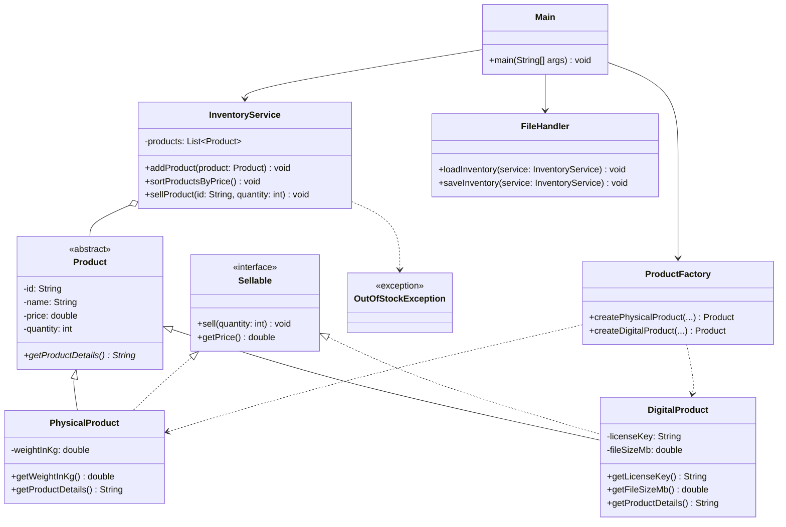

# Tervezési dokumentáció – Okos Raktárkezelő

## 1. Problem Statement
A raktárkezelők és kisvállalkozások számára gyakran okoz gondot, hogy egyszerre kezeljenek fizikai (súllyal és raktárkészlettel bíró) és digitális (licenckulccsal és fájlmérettel rendelkező) termékeket egy egységes, átlátható rendszerben. Az alkalmazás célja egy konzolos raktárkezelő biztosítása, amely egységes objektummodellben kezeli a termékeket, ellenőrzi a készletet, kivétellel jelzi a készlethiányt, rendezést támogat, és a futások között fájlból menti/tölti vissza a készletet.

## 2. User Storyk
- **US-01:** Raktárosként szeretnék új fizikai és digitális termékeket felvenni, hogy a teljes készlet nyilvántartható legyen.
- **US-02:** Raktárosként szeretném listázni a raktárban lévő termékeket, hogy lássam az aktuális adatokat és készleteket.
- **US-03:** Raktárosként szeretném eladni a kiválasztott termékből megadott mennyiséget, és hibajelzést kapni, ha nincs elég készlet (`OutOfStockException`).
- **US-04:** Raktárosként szeretném ár szerint rendezni a termékeket, hogy könnyebben áttekintsem az árkategóriákat.
- **US-05:** Raktárosként szeretném a készletet kilépéskor menteni és indításkor visszatölteni, hogy ne vesszenek el az adatok.

## 3. UML osztálydiagram
A szerkeszthető PlantUML forrás a `docs/class-diagram.puml` fájlban található.

## 4. Tervezési minta: Factory (`ProductFactory`)
- **Megoldott probléma:** A `Main` (UI réteg) így nem közvetlenül a konkrét termékkonstruktorokkal példányosítja a fizikai és digitális termékeket, hanem egy közös `Product` absztrakció mögött egységesen hozza létre őket.
- **Kapcsolat a UML-lel és a kóddal:** A `hu.raktar.service.ProductFactory` osztály (`createPhysicalProduct(...)` és `createDigitalProduct(...)` metódusok) példányosítja a `hu.raktar.domain.PhysicalProduct` és `hu.raktar.domain.DigitalProduct` osztályokat (amelyek a `Product` ősosztályból származnak), a `Main` pedig a `ProductFactory`-t hívja meg a 2-es és 3-as menüpontban.
- **Előny:** Könnyebben bővíthető új terméktípussal vagy módosítható a példányosítási logika anélkül, hogy a menülogikát szét kellene szórni.

## 5. Főbb tervezési döntések és ismert korlátok
### Tervezési döntések
- **Csomagok szerinti rétegzés (`hu.raktar`):** Különválasztott `domain`, `service`, `persistence`, `exception` és `ui` csomagok az átláthatóság és a felelősségek szétválasztása érdekében.
- **Egyedi azonosítók és készletellenőrzés:** Az `InventoryService` megakadályozza a duplikált termék-ID-k felvételét, eladáskor pedig készlethiány esetén `OutOfStockException`-t dob, a `Main` pedig kiírja az elérhető mennyiséget és újrakérdezi az eladandó darabszámot.
- **Rendezés és perzisztencia:** A termékek ár szerint rendezhetők (`Comparable`), a mentés/visszatöltés pedig `FileHandler` segítségével történik.

### Ismert korlátok
- Egyszerű konzolos (CLI) felhasználói felület áll rendelkezésre, grafikus felület (GUI) nincs.
- A fájlalapú perzisztencia egyszerű szöveges formátumra épül, ezért a belső elválasztó karakterek használata a névben vagy licenckulcsban korlátozott.